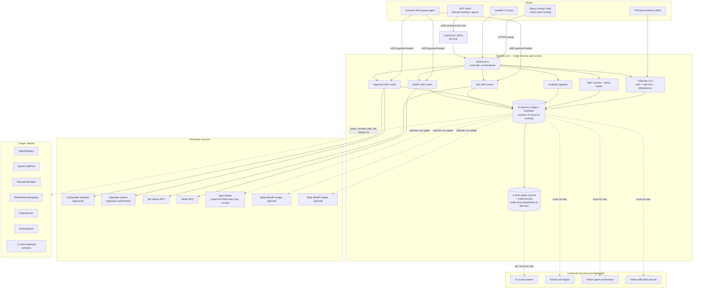

# Cred402 — Real Architecture (2026-10-23)

Scope note: competitive positioning and growth moves are covered in `STRATEGY-2026-10-23.md`
(already written). This file covers only: system diagram, data flow, risks, and next-build
list. No `PLAN-2026-10-23-DEEP.md` existed at the time this was written — no duplication.

Grounding: read `package.json`, `render.yaml`, `frontend/vercel.json`, `infra/docker-compose.yml`,
`infra/Dockerfile`, `api/server.ts`, `api/v1/router.ts`, `lib/gateway/persistence.ts`,
`api/algorand_x402_routes.ts`, `api/qie_x402_routes.ts`, `api/near_x402_routes.ts`,
`deploys.addresses.txt`, `mcp/server_sdk.ts`, `.github/workflows/ci.yml`, and the `services/*`
and `contracts/*` trees directly. Every component below exists in the repo as read; nothing
invented.

## 0. What this actually is (stack facts)

- **Runtime:** Node.js 20, TypeScript, ESM, executed via `tsx` (no build step, no framework —
  raw `node:http`). `npm start` runs `tsx api/server.ts`.
- **Hosting target (confirmed, not assumed):** this product does **not** run on the Oracle
  boxes or Cloudflare Workers used by other portfolio products.
  - API: **Render.com**, free-tier web service (`render.yaml`), single always-on Node process,
    live at `https://cred402-1.onrender.com`, health check `/v1/health`.
  - Frontend: **Vercel** (`frontend/vercel.json`), React 18 + Vite static build, with rewrites
    proxying `/api/*`, `/v1/*`, `/graphql` to the Render API.
  - A `Dockerfile` + `docker-compose.yml` exist for self-hosted/local-prod use (API + Go
    indexer + Postgres) but Postgres is **not** part of the actual Render deployment.
- **Database:** there is **no external database in production.** The system of record at
  runtime is an in-memory `Ledger`/`EventBus` (`lib/ledger`). Durability comes from
  `LedgerJournal` (`lib/gateway/persistence.ts`): every emitted event is appended to
  `events.ndjson` under `CRED402_DATA_DIR`, replayed on boot, plus periodic atomic JSON
  snapshots. On Render free tier this directory is `/tmp/cred402` — **ephemeral**, wiped on
  every restart/redeploy (`render.yaml` says this explicitly in its own comments).
- **On-chain layer:** 14 Rust/WASM smart contracts are written for Casper and **actually
  deployed to Casper Testnet** with real deploy hashes recorded in `deploys.addresses.txt`
  (AgentRegistry, X402ReceiptRegistry, RWAEvidenceRegistry, RiskPolicyManager,
  AgentCreditPool, ReputationEngine, AgentPassport, DisputeCourt, RWAAssetRegistry,
  SlashingVault, Governance, FiatReceiptRegistry, OperatorVerificationRegistry,
  RealFiAttestationRegistry). Additional contract source trees exist for EVM, Solana, Cosmos,
  Move, Bitcoin, and Flare, but only the Casper set has recorded live addresses — the rest are
  source-only / not confirmed deployed anywhere.
- **x402 payment rails wired into the API:** Algorand (`api/algorand_x402_routes.ts`, via the
  GoPlausible facilitator + Algonode indexer, Bazaar-discoverable), QIE
  (`api/qie_x402_routes.ts`, EVM-compatible via `@x402/evm`, own RPC + confirmation check),
  NEAR (`api/near_x402_routes.ts`, self-verified against NEAR RPC, no facilitator). All three
  fail closed with HTTP 503 if their pay-to address env var is unset — confirmed in code, not
  a config toggle that silently degrades to "free."
  - **Gap found:** `render.yaml` (the actual live deployment manifest) only sets the
    `CRED402_ALGORAND_*` env block. It sets **no `CRED402_QIE_*` or NEAR equivalent vars at
    all.** The QIE and NEAR paid credit-score endpoints are fully coded and tested
    (`test/qie_x402.test.ts`, `test/near_x402.test.ts`) but on the live Render instance today
    they return 503 — this matches the strategy doc's claim that QIE/NEAR "just need env vars
    filled in," confirmed here at the deployment-manifest level, not just the code level.
- **MCP server:** `mcp/server_sdk.ts` exposes 80 tools (`mcp/tools.ts`, counted directly) over
  **stdio transport only** (`StdioServerTransport`) — it is a local subprocess a client (e.g.
  Claude Desktop, an MCP-aware agent) spawns and talks to over stdin/stdout. There is **no
  hosted/remote MCP HTTP endpoint.** `package.json` has `"private": true` and no `bin` field,
  so the strategy doc's growth move ("publish to the MCP server directory") currently has no
  publishable npm package to point at — this is a real gap, listed below.
- **Auxiliary services** (`services/*`), all local-only, none deployed to Render/Vercel:
  Go event-indexer (tails `events.ndjson`, projects to `projections.json` or Postgres),
  Python risk-engine (advisory scoring microservice, stdlib-only), Python agent-orchestrator
  (policy-gated autonomous agent runtime, "LLM proposes, policy engine disposes"), Node
  notification-service (Slack/Discord/webhook delivery). None of these run in the live
  topology today — they exist as separately runnable local tools/demos.
- **CI:** `.github/workflows/ci.yml` exists (per owner standing rule, no CI/CD work is to be
  done on this — noted, not touched).
- **Clients:** React/Vite console (Vercel), CLI (`cli/cred402.ts`), SDKs in TypeScript, Python,
  Go, Rust (`sdk/`), and the MCP tool surface — all talk to the same Render API over
  `/api/*` (console/demo surface) or the versioned `/v1/*` (scoped-API-key, rate-limited,
  idempotent REST surface built in `api/v1/router.ts`).

## 1. System diagram

## 2. Data flow — 2-3 key actions, exact path

### A. External agent pays 0.01 USDC for a credit-score lookup (Algorand x402 rail — the paid product's actual core transaction)

1. Agent `GET /v1/x402/algorand/credit-score/:agentId` with no payment header →
   `api/algorand_x402_routes.ts` returns HTTP 402 with a signed payment challenge
   (`CRED402_ALGORAND_PAY_TO`, exact micro-USDC price, network).
2. If `CRED402_ALGORAND_PAY_TO` is unset, the route fails closed with **503** before any
   challenge is issued — confirmed in code; never silently free.
3. Agent signs and submits an Algorand USDC transfer, retries the request with the x402
   payment proof header.
4. `algorand_x402_routes.ts` calls the **GoPlausible facilitator** to verify/settle the
   payment, then independently re-checks finality against the **Algonode indexer**
   (`CRED402_ALGORAND_MIN_FINALITY_ROUNDS`) rather than trusting the facilitator alone.
5. On confirmed settlement: the route reads the agent's score from the in-memory `Ledger`
   (`state.ledger` — reputation/credit computed from prior receipts/disputes), returns the
   paid JSON credit-report response, and emits a `ChainEvent` onto the `EventBus`.
6. `LedgerJournal` (subscribed to the `EventBus`) appends that event to
   `events.ndjson` under `CRED402_DATA_DIR` for durability/replay.
7. A background reconciliation loop (`startAlgorandReconciliation`, started once at server
   boot in `api/server.ts`) periodically re-confirms pending settlements against the indexer
   in case the facilitator's initial response was indeterminate.

### B. Agent registers, earns reputation, and draws a credit line (core protocol loop)

1. Client (CLI, SDK, or orchestrator agent) calls `/v1/agents` (register) →
   `V1Router.handle()` runs: scoped-API-key auth → rate limit → body validation →
   idempotency-key dedupe (if `Idempotency-Key` header present) → handler.
2. Handler writes the new agent into the in-memory `Ledger` and (async, not blocking the
   response) submits a Casper deploy to the on-chain `AgentRegistry` contract.
3. As the agent completes paid jobs (x402 receipts from flow A, or simulated jobs in
   demo mode), `agents/economy.ts` updates reputation/credit score in the `Ledger` and emits
   events; `ReputationEngine` and `RiskPolicyManager` contracts mirror this on Casper.
4. Agent calls `/v1/credit/draw` (or the `AgentCreditPool` contract directly) to draw against
   an open credit line. The handler re-checks current reputation/collateral in the `Ledger`
   before allowing the draw (`lib/services/safe_draw.ts`), then records the draw.
5. Every state transition is an `EventBus` event → appended to `events.ndjson` →
   (if the Go indexer is running locally) projected into `projections.json`/Postgres for
   analytics; on the live Render deployment this projection step does not run, so the
   `/v1/*` read endpoints hitting the in-memory `Ledger` directly are the only production
   read path.

### C. RWA evidence submitted, disputed, and (if false) slashed

1. An evidence-seller agent calls the paid evidence endpoint
   (`api/paid_evidence_server/index.ts`) to sell verification data (e.g. solar/GHI readings
   sourced live, free, from **Open-Meteo**) against the `RWAEvidenceRegistry` contract.
2. A buyer agent disputes the evidence via `/v1/disputes` → `dispute_judge_agent.ts` +
   the on-chain `DisputeCourt` contract adjudicate.
3. If evidence is found falsified, `SlashingVault` is called on-chain to burn/redirect the
   offending agent's staked collateral; the `Ledger` mirrors the updated reputation/stake,
   and a dispute-resolution event is journaled exactly as in flows A/B.

## 3. Architectural risks / bottlenecks (current scale, zero budget)

- **Ephemeral state of record.** The in-memory `Ledger` + `events.ndjson` journal lives on
  Render's free-tier ephemeral filesystem. Every redeploy/restart wipes it: leaderboard
  standing, x402 usage counters, the replay-protection barrier, and all finalized-receipt
  history reset to empty. `render.yaml`'s own comments acknowledge this; it is a real,
  already-documented risk, not a hypothetical one.
- **Cold starts on a paid endpoint.** Render free tier sleeps idle instances. A buyer agent's
  x402-paid request can time out on a cold start — this is lost paid volume, not just lost
  UX, which directly works against the growth moves (agents discovering a priced endpoint via
  Bazaar/x402 directories and bouncing off a timeout).
  - Note: this is the same risk the strategy doc flags for Clawloan-style traction — cred402
    cannot afford to lose its first real paid calls to a cold start.
- **QIE and NEAR paid rails are coded but not live.** `render.yaml` only wires Algorand env
  vars. Until an operator adds `CRED402_QIE_PAY_TO`/network/RPC and the NEAR equivalent to the
  Render dashboard, those two differentiated multi-chain rails (a stated competitive edge vs.
  Clawloan's single-ecosystem lock-in) are 503 in production — the differentiation exists in
  the repo but not in what a real agent can call today.
- **No hosted MCP endpoint, no publishable package.** The 80-tool MCP server only speaks
  stdio and `package.json` is `"private": true` with no `bin` entry — the growth move "publish
  to the MCP directory" has no artifact to publish yet. This is a packaging gap, not a code
  gap.
- **Single Node process, no horizontal scale path.** The entire API (REST, GraphQL, SSE event
  stream, three x402 payment domains) is one `node:http` process holding the only copy of
  state in memory. Fine at today's (effectively zero) traffic; it has no multi-instance story
  — a second Render instance would have a divergent `Ledger`, so scaling past one instance
  requires the Postgres/indexer path that exists only in `docker-compose.yml`, not in
  production.
- **Local-only services never see production traffic.** Risk-engine, agent-orchestrator,
  notification-service, and the Go indexer are real, tested code but run against
  `localhost:4021` in their own docs — none are wired to the live Render URL, so today's
  production deployment has no fraud-advisory scoring, no outbound notification delivery
  (Slack/Discord), and no analytics projection running against real traffic.
- **Five parallel hackathon-shaped surfaces, one free backend.** Algorand, QIE, NEAR, Casper,
  and Flare/KeeperHub integrations all share the one Render free instance and one in-memory
  ledger. A spike from any single discovery channel (e.g. Bazaar listing traffic) competes
  for the same ephemeral resources as every other rail.

## 4. Prioritized next-build list (effort vs. impact)

1. **Wire QIE + NEAR env vars into `render.yaml` and the Render dashboard.** Lowest effort
   (config only, code already shipped and tested), unlocks two of the five differentiation
   claims in the strategy doc immediately — turns already-written code into live, callable,
   paid endpoints.
2. **Move `CRED402_DATA_DIR` onto a paid Render disk (or any durable volume) and upgrade off
   the free plan for the API service.** Directly removes the ephemeral-state and cold-start
   risks above, which are the two biggest reliability threats to converting discovery traffic
   (Bazaar, x402 directories) into retained paid usage. Costs real money, so this is an
   owner-budget decision — but it is the single highest-impact reliability fix available.
3. **Publish an npm package for the MCP server (drop `"private": true`, add a `bin` entry for
   a `cred402-mcp` stdio entrypoint) and submit it to the official MCP server directory /
   Claude Desktop extension listing.** Directly unlocks the strategy doc's second growth move;
   currently blocked purely by packaging, not by missing functionality.
4. **Wire the Go event-indexer + a managed Postgres into the production topology** (even a
   free-tier Postgres, e.g. Render's own Postgres free tier or Neon) so `/v1/*` analytics
   reads stop depending solely on the single process's in-memory `Ledger`, and so a future
   second API instance has somewhere to read shared state from. Medium effort (the indexer and
   schema already exist in `docker-compose.yml`/`db/migrations`), unlocks real multi-instance
   scaling later.
5. **Point the existing notification-service at the live Render deployment's event feed** (it
   already supports Slack/Discord/webhook delivery) so a real external channel gets pinged on
   first-ever paid x402 settlement, first default, first dispute — turns an already-built
   local tool into a live operational signal with near-zero new code.
